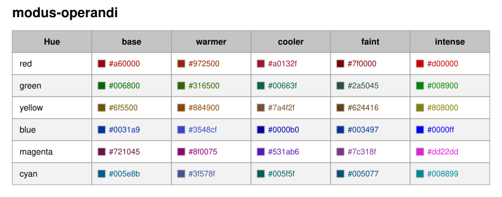
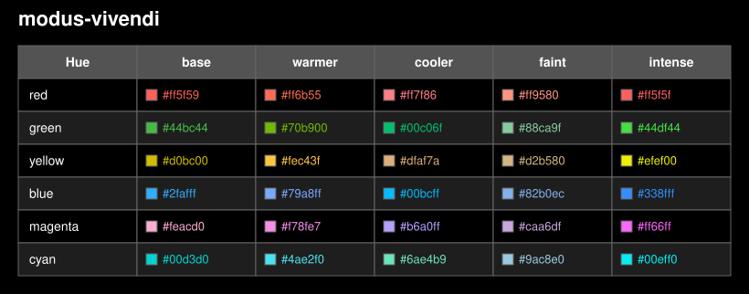

# Modus Themes Ports

[](LICENSE)
[](https://www.python.org/)

Ports of the [Modus themes](https://protesilaos.com/emacs/modus-themes) for developer tools and editors.

Modus themes are designed by [Protesilaos Stavrou](https://protesilaos.com/about/) with a focus on accessibility—conforming to the highest legibility standard (WCAG AAA). They ship in light/dark variants with tinted and color-deficiency friendly flavors (deuteranopia, tritanopia).

## Supported Tools

| Tool | Description |
|------|-------------|
| [Amp](ports/amp/README.md) | AI coding agent CLI |
| [bat](ports/bat/README.md) | Cat clone with syntax highlighting |
| [Glamour](ports/glamour/README.md) | Markdown style JSON format |
| [Glow](ports/glow/README.md) | Markdown previewer |
| [Ghostty](ports/ghostty/README.md) | Terminal emulator |
| [Helix](ports/helix/README.md) | Modal text editor |
| [Lazygit](ports/lazygit/README.md) | Terminal UI for git |
| [LS_COLORS](ports/ls-colors/README.md) | Colors for `ls` and compatible tools |
| [OpenCode](ports/opencode/README.md) | AI coding agent CLI |
| [Pi](ports/pi/README.md) | AI coding agent CLI |
| [tmux](ports/tmux/README.md) | Terminal multiplexer |
| [Visual Studio Code](ports/vscode/README.md) | Code editor |
| [Xcode](ports/xcode/README.md) | Apple IDE |
| [Yazi](ports/yazi/README.md) | Terminal file manager |
| [Zed](ports/zed/README.md) | Code editor |

Screenshots: [SCREENSHOTS.md](SCREENSHOTS.md)

## Quick Start

```sh
# List available tools and themes
python3 scripts/modus.py list

# Install themes for a tool (creates symlinks)
python3 scripts/modus.py install --tool ghostty

# Install a specific theme
python3 scripts/modus.py install --tool ghostty --theme modus-operandi
```

Themes are symlinked into each tool's native theme directory by default. See the tool-specific README for its destination and activation instructions.

## Palette Snapshots

Rendering uses the checked-in CC0 JSON snapshots under `palettes/`; Emacs is not needed to use, install, render, or contribute theme ports. Maintainers only need Emacs when reproducibly synchronizing those downstream snapshots with the exact upstream revision recorded in [`upstream.lock.json`](upstream.lock.json).

## Theme Variants

| Variant | Light | Dark |
|---------|-------|------|
| Default | `modus-operandi` | `modus-vivendi` |
| Tinted backgrounds | `modus-operandi-tinted` | `modus-vivendi-tinted` |
| Deuteranopia (red-green) | `modus-operandi-deuteranopia` | `modus-vivendi-deuteranopia` |
| Tritanopia (blue-yellow) | `modus-operandi-tritanopia` | `modus-vivendi-tritanopia` |

## Accent Hue Reference

Preview of the core accent foreground hues by variant (base, warmer, cooler, faint, intense).

> [!NOTE]
> Port-specific palette choices live in each tool template; extracted palettes remain unmodified CC0 data.





## Contributing

See [CONTRIBUTING.md](CONTRIBUTING.md) to add new ports—no-code templates supported.

## Credits

All credit for the Modus themes design goes to [Protesilaos Stavrou](https://protesilaos.com/about/). This project ports his work to additional tools.

- Upstream repository: [protesilaos/modus-themes](https://github.com/protesilaos/modus-themes)
- Related project: [protesilaos/modus-themes-exporter](https://github.com/protesilaos/modus-themes-exporter) — an Emacs package that exports Modus themes to other applications, currently focused on `xterm`/`urxvt`
- Manual: [Modus Themes Manual](https://protesilaos.com/emacs/modus-themes)

## License

Project code and rendered ports are MIT-licensed; Modus palette data is CC0. See [LICENSE](LICENSE).
