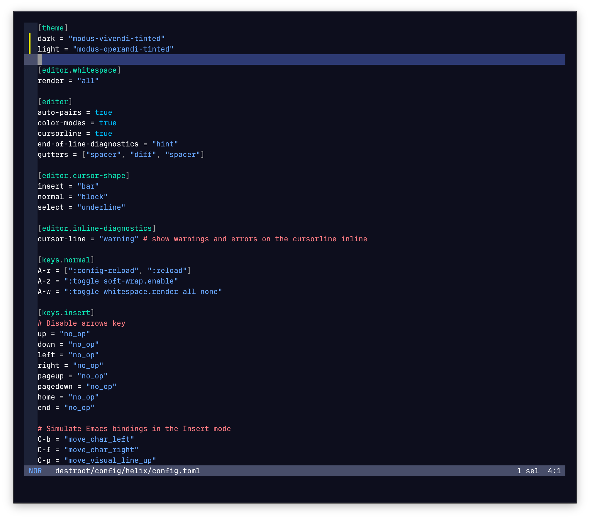

# Helix Themes

Modus Themes for the [Helix](https://helix-editor.com) editor.

> [!NOTE]
> Helix ships with built-in `modus_operandi` and `modus_vivendi` themes.
> This port provides an alternative with a cleaner gutter (no background color)
> and less distracting comments (grey instead of red).

| Built-in Helix Theme | This Port |
| --- | --- |
|  |  |

## Installation

Install all themes using symbolic links:

```sh
python3 scripts/modus.py install --tool helix
```

## Usage

Add to your `~/.config/helix/config.toml`:

```toml
theme = "modus-vivendi"
```

See the repository's [theme variant table](../../README.md#theme-variants) for the complete list of light, dark, tinted, and color-deficiency variants.

## Uninstall

```sh
python3 scripts/modus.py uninstall --tool helix
```
